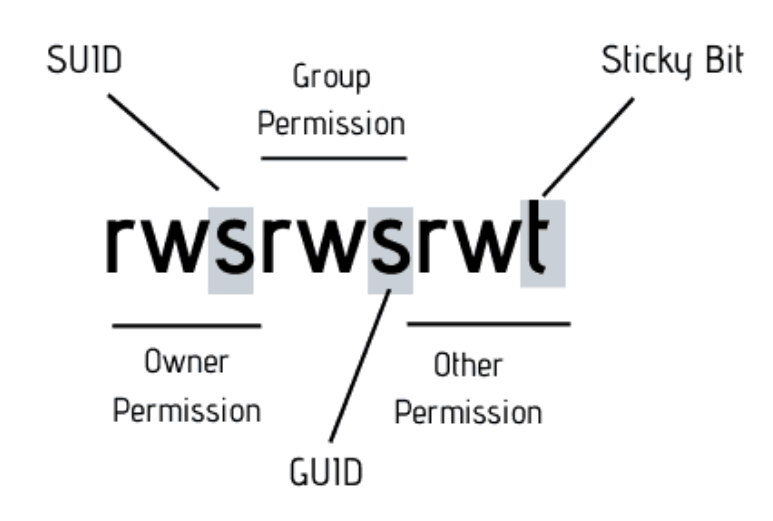

# Narnia0

SSH Information
```bash
Host: narnia.labs.overthewire.org
Port: 2226
Username: narnia0
Password: narnia0
```

In this lab we will learn how to login to a Linux machine. We guide you through the login process and get to know the system. Try to run the commands without looking at the results yet, check the hints if you are stuck. From the next lab onwards we will provide less hints.

### Login
Open a terminal (or use your favorite SSH client) and login via SSH using the information above.
You should receive a message similar to the following:

```bash
~ $ssh narnia0@narnia.labs.overthewire.org -p 2226
                                                _       
                         _ __   __ _ _ __ _ __ (_) __ _ 
                        | '_ \ / _` | '__| '_ \| |/ _` |
                        | | | | (_| | |  | | | | | (_| |
                        |_| |_|\__,_|_|  |_| |_|_|\__,_|


                      This is an OverTheWire game server. 
            More information on http://www.overthewire.org/wargames

backend: gibson-1
narnia0@narnia.labs.overthewire.org's password: 
```

Next you see a message that the server is running a game called "Narnia" and some information about the server. Scroll up and read the information.
You should see the prompt:

> narnia0@narnia:~$ 
Now you are logged in. Let's start hacking!


## 1. Get to know the system
Let us start by getting to know the system in which we are working.

We can check which user we are and what the operating system is by running the following commands:

### Q1. What is the output of the following commands?
```bash
narnia0@narnia:~$ whoami                # narnia0
narnia0@narnia:~$ cat /etc/os-release   # Ubuntu 26.04.1 LTS
narnia0@narnia:~$ lscpu                 # Intel(R) Xeon(R) Platinum 8259CL CPU @ 2.50GHz
```
- whoami : prints which user we are logged in as.
- cat /etc/os-release : prints the os version.
- lscpu : prints cpu architecture, model, threads, cores, ... 


Now we continue to get to know the system.
```bash
narnia0@narnia:~$ pwd                             # Print current directory.
narnia0@narnia:~$ ls                              # List files in the current directory, empty!?
```

#### Q2. How can you list all files in the current directory and check the permissions for each file? (HINT: ls --help)
Remember : 
- `d rwx r-x r-x` gives us information about the permissions.
- The first letter indicates the type of file (d = directory, - = file).
- The first set of 'rwx' is the permission for the user(owner), the second for the group and the third for other users.
- If there is a "-" it means that the permission is not set.
- The third column indicates owner (user) name while the fourth indicates group name. The permissions are: (r)read, (w)write, e(x)ecute

Answer :
- `ls -la`
```bash
narnia0@narnia:~$ ls -la
total 20
drwxr-xr-x   2 root root 4096 Oct 25 13:39 .
drwxr-xr-x 150 root root 4096 Oct 25 13:40 ..
-rw-r--r--   1 root root  220 Feb 13  2026 .bash_logout
-rw-r--r--   1 root root 3851 Oct 25 13:21 .bashrc
-rw-r--r--   1 root root  807 Feb 13  2026 .profile
```


There seem to be no interesting files in the current directory. Let us go and find something interesting!

Generally, the root directory is the directory that is the highest level in the directory tree.

In Ubuntu:
|directory	|what it is|
|-----------|----------|
|/	|is the root directory|
|/etc|	is a folder that contains configuration files|

#### Q3. Have a look in the root directory and the /etc folder. There is something interesting in the /etc folder.
```bash
# Look at the root folder
ls /

# Look at the /etc folder
ls /etc

# Found the file that stores the passwords !
narnia0@narnia:~$ ls /etc | grep narnia_pass
narnia_pass
```


#### Q4. Have a look in that directory try to read the content of the files. Have a look at the permissions of the files.
```bash
# List files inside the directory
narnia0@narnia:~$ ls /etc/narnia_pass/
narnia0  narnia1  narnia2  narnia3  narnia4  narnia5  narnia6  narnia7  narnia8  narnia9
# try and read the password for narnia0 (the user we are logged in as)
narnia0@narnia:~$ cat /etc/narnia_pass/narnia0
narnia0
# try to read other users password - permission denied
narnia0@narnia:~$ cat /etc/narnia_pass/narnia1
cat: /etc/narnia_pass/narnia1: Permission denied
narnia0@narnia:~$ cat /etc/narnia_pass/narnia2
cat: /etc/narnia_pass/narnia2: Permission denied
# list permisions, we only have permissions for our own user
narnia0@narnia:~$ ls -la /etc/narnia_pass/
total 56
drwxr-xr-x   2 root    root     4096 Oct 25 13:39 .
drwxr-xr-x 128 root    root    12288 Nov  1 13:23 ..
-r--------   1 narnia0 narnia0     8 Oct 25 13:39 narnia0
-r--------   1 narnia1 narnia1    11 Oct 25 13:39 narnia1
-r--------   1 narnia2 narnia2    11 Oct 25 13:39 narnia2
-r--------   1 narnia3 narnia3    11 Oct 25 13:39 narnia3
-r--------   1 narnia4 narnia4    11 Oct 25 13:39 narnia4
-r--------   1 narnia5 narnia5    11 Oct 25 13:39 narnia5
-r--------   1 narnia6 narnia6    11 Oct 25 13:39 narnia6
-r--------   1 narnia7 narnia7    11 Oct 25 13:39 narnia7
-r--------   1 narnia8 narnia8    11 Oct 25 13:39 narnia8
-r--------   1 narnia9 narnia9    11 Oct 25 13:39 narnia9
```


---
## 2. Try to find a way to read those files


#### Q2.1 - There is another interesting folder in the root directory. Try to find it.
```bash
narnia0@narnia:~$ ls -la /narnia/
-r-sr-x---  1 narnia1 narnia0 15040 Oct 25 13:39 narnia0
-r--r-----  1 narnia0 narnia0  1250 Oct 25 13:39 narnia0.c
...
```
Notes : 
```bash
narnia0 : 
    - is a regular file      : -
    - owner                  : narnia1
    - owner permissions      : r-s      # 
    - group owner            : narnia0
    - g.o. permissions       : r-x      # read and execute
    - permissions for others : ---      # no permissions
```
This means that we (narnia0) as the group owner, can read and execute this file, but not modify it.

Sources : 
- File permissions : https://linuxhandbook.com/linux-file-permissions/
- SUID, GUID : https://linuxhandbook.com/suid-sgid-sticky-bit/


### Quick overview:
SUID : 
- When the SUID bit is set on an executable file, this means that the file will be executed with the same permissions as the owner of the executable file.

ex.
```bash
vass@NightBlue:~$ ls -l /usr/bin/passwd
-rwsr-xr-x. 1 root root 91736 Jul 29  2025 /usr/bin/passwd
```
-> This means that any user running the passwd command will be running it with the same permission as root.
- the passwd command needs to be runnable by any user for them to change their own password.
- but this command thus need to edit files like `/etc/passwd`, `/etc/shadow`, which are owned by root and only modifiable by root.
- This is what SUID fixes.

- Note that the passwd command still checks the UID of th user running the command with the UID of the user whose password is being modified, so you cannot change other's password.

- `Conclusion :` SUID allows a file to be executed with the same permissions as the owner of the file. 


```bash
# set the suid
chmod u+s file_name

# remove it
chmod u-s test.txt

# find all files with suid set 
find / -perm /4000

```
Note :
- if the file initially doesn't have any permission to be ran, and we still add SUID, it will show a capital S. This is an error and tells us to fix it.


**SGID :**
- Same as suid, but gives the same permissions to any user running the file as the group owner and not the file owner.
- useful for directories handling : files created inside this directory will get the same group ownership as main directory (not the group ownership of the user that created the files and directories). 
```bash
# set the sgid
chmod g+s directory_name

# remove it
chmod g-s folder

# find all files with sgid set 
find . -perm /2000
```


**Sticky bit :**
- when set on a directory, all the files in the directory can only be deleted or renamed by the file owners only or the root.
- typically set on `/tmp`:
```bash
vass@NightBlue:~$ ls -ld /tmp
drwxrwxrwt. 29 root root 800 Nov 12 12:10 /tmp
```
- notice it has `t` on the same place we expect to see `x` or `-` for other permissions.
- This means that a user (except root) cannot delete the temporary files created by other users in the /tmp directory.
```bash
# set the sticky bit
chmod +t my_dir

# remove it
chmod -t my_dir

# find all files with sticky bit set 
find . -perm /1000
```

#### Summary



---
## 3. The crux of the matter
You might also have noticed there is an 's' in the permissions, this indicates `setuid` or `setgid` permission bit has been set. In this case it is the setuid permission bit since we see the 's' in the user permissions.
(When the 's' is in the group permissions, it is the setgid permission bit.)

Remember that :
```bash
-r-sr-x---  1 narnia1 narnia0 15040 Oct 25 13:39 narnia0
```
- the s here means SUID, meaning any user running this file will run it as the file owner.
- so narnia0 can run this file as narnia1
- note that 'others' has no permissions to run this file anyway, so only the g.o. can really run this file as the owner.


The result of this permission is that if we run narnia0, we will run it as if we have the permission of narnia1 (the user/owner). This makes it interesting for us because narnia1 has access to the password file. If we can find an exploit (= take advantage of a vulnerability in the source code) for this narnia0 executable, we might get to the password for user narnia1.

This source code contains a vulnerability that will allow us to read the password for user narnia1.

> Negligence?!
You might wonder why one could be so negligent to give highter permissions (eg. root) to a file. Well if you have ever built Kernel Drivers (RnD Embedded Developers 😉), then you know that to be able to access certain hardware devices, you need more permissions. Before the current access control system (udevadm) existed, people tended to solve this issue by using the s-bit. There are still use cases where the s-bit is useful, but that goes beyond the scope of this course.


## 4. The quest for the vulnerability
Last year, in the course Operating Systems, we learned about different ways to read from the input. We mentioned briefly you should be careful. This is the moment where we will learn about the dangers of reading from the input.

Have a look at the source code of narnia0.

```bash
narnia0@narnia:/narnia$ cat narnia0.c
```
Output :
```c
/*
   This program is free software; you can redistribute it and/or modify
   it under the terms of the GNU General Public License as published by
   the Free Software Foundation; either version 2 of the License, or
   (at your option) any later version.

   This program is distributed in the hope that it will be useful,
   but WITHOUT ANY WARRANTY; without even the implied warranty of
   MERCHANTABILITY or FITNESS FOR A PARTICULAR PURPOSE.  See the
   GNU General Public License for more details.

   You should have received a copy of the GNU General Public License
   along with this program; if not, write to the Free Software
   Foundation, Inc., 51 Franklin St, Fifth Floor, Boston, MA  02110-1301  USA
   */
#include <stdio.h>
#include <stdlib.h>
#include <unistd.h>

int main(){
    long val=0x41414141;        // 
    char buf[20];               // 

    printf("Correct val's value from 0x41414141 -> 0xdeadbeef!\n");
    printf("Here is your chance: ");
    scanf("%24s",&buf);                 // user input

    printf("buf: %s\n",buf);
    printf("val: 0x%08x\n",val);

    if(val==0xdeadbeef){
        setreuid(geteuid(),geteuid());
        system("/bin/sh");
    }
    else {
        printf("WAY OFF!!!!\n");
        exit(1);
    }

    return 0;
}

```

Now it is time to refresh your knowledge about C and the stack...
Try to find out what happens in the source code.

### Q4.1 - What happens?


### Q4.2 - Look for the vulnerability.

### Q4.3 - Draw a stack diagram for the program.


### Get stack information
Use gdb to get information about the stack. Useful commands:
- start: starts the program
- ni: executes the next instruction
- info proc mappings: A way to see the memory regions mapped by a process.
- x/20x $esp: prints 20 units at address $esp in hex using the default unit size (word; usually 4 bytes on x86). So you’ll see 20 words (4-byte values) in hex.

### Q4.4 - Show me the commands


So we need to find a way to overwrite the value on the stack next to buf with the value 0xdeadbeef.
We can see in the previous debug screen that we are able to overwrite the value on the stack next to buf, which is val.

We could use python to do this or printf, but we can also use the echo command:
0xdeadbeef needs to be written in little endian format, which is: 0xefbeadde

The command echo -e will encode the hexadecimal values in the string.
Using the pipe symbol | sends the output of the echo command to the input of the next program.
(echo -e "Hello World")|myprogram


### Q4.5 - Try to write this command yourself to get the correct value.


As you can see, the program immediately stops.
We need to use cat to keep the program running. (echo -e "Hello World";cat)|myprogram will keep on waiting for input. Next you see the cursor blinking.
---

## 5. The exploit works!


---- end